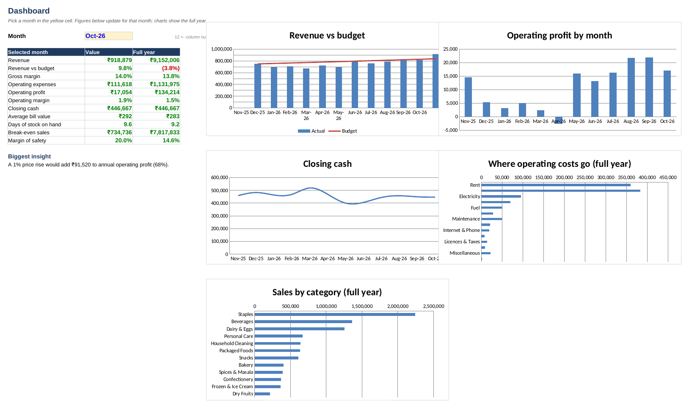

# Kirana Store: Monthly Financial Report (Excel)

**A kirana store sold ₹91.5 lakh in a year. How much did it actually keep, and what would change that?**
This is a monthly management report of the kind an FP&A analyst builds, made in Excel with live formulas. It covers P&L, budget vs actual, cash flow, financial ratios and what-if scenarios.

> **About the data:** the store (Gupta General Store, Laxmi Nagar, Delhi) is hypothetical and its data is **simulated**. The monthly figures come from the SQL database in my [kirana-store-sql](https://github.com/areebalam49-lgtm/kirana-store-sql) project, so this workbook is the finance view of that same business.

---

## Key findings (FY Nov 2025 – Oct 2026)

| Metric | Value |
|---|---|
| Revenue | ₹91.5 lakh |
| Gross margin | 13.8% |
| Operating profit | ₹1.34 lakh (**1.5% margin**) |
| Revenue vs budget | 3.8% below |
| Closing cash | ₹4.47 lakh |
| Days of stock on hand | 9 days |
| Break-even sales | ₹78.2 lakh a year (margin of safety 14.6%) |

1. **Thin margins make pricing powerful.** The store keeps just ₹1.50 of every ₹100 sold. A **1% price rise would add ₹91,520 to annual profit (+68%)**, and a 2% price cut would push it into a loss.
2. **One month made a loss.** April 2026 ran at an operating loss of ₹2,645: revenue dipped while electricity and maintenance costs rose.
3. **Some costs ran over budget.** Maintenance was 37% over, electricity 14% over, and wastage and expiry 15% over. Rent and salaries were exactly on budget.
4. **Cash is healthy despite low profit.** Selling down the opening stock and turning inventory about 40 times a year keeps cash steady at ₹4–5 lakh.

---

## What's inside the workbook

| Sheet | What it shows |
|---|---|
| **Dashboard** | Pick a month from a dropdown and the key figures update; 5 charts for the full year |
| **P&L** | Monthly revenue, cost of goods, gross profit, 13 expense lines, depreciation, operating profit |
| **Budget vs Actual** | Monthly and full-year variances, plus an expense-by-category status (Within budget / Slightly over / Over by >10%) |
| **Cash Flow** | Cash sales, khata (credit) collected a month later, supplier payments, expenses, equipment and closing cash, with a balance check |
| **Ratios** | Gross and operating margin, average bill, bills per day, inventory turnover, days of stock, contribution margin, break-even sales, margin of safety |
| **What-If** | Levers for price, volume, supplier cost, rent, salaries and wastage, plus a price sensitivity table |
| **Assumptions** | Opening balances, budget and what-if levers: the only sheet to edit |
| **Data** | Monthly figures pulled from the SQL database, with the source query noted for each line |

**Built to finance-model standards:** 959 formulas with zero errors; blue inputs, black formulas and green cross-sheet links; every assumption in its own labelled cell; negatives in brackets.

## Excel skills used
`INDEX` + `MATCH` (month selector) · `SUM`/`AVERAGE` · `IF`/`ABS` checks · data validation dropdowns · conditional formatting · combo, bar and line charts · linked multi-sheet model · scenario and sensitivity analysis

## Files

| File | What it is |
|---|---|
| `Kirana_Store_Financial_Report.xlsx` | The workbook |
| `dashboard.png` | Dashboard screenshot |
| `build_report.py` | Python script that pulls the monthly figures from the SQL database and builds the workbook |

---

**Mohd Areeb Alam** · B.Tech, NSUT (2027) · [LinkedIn](https://www.linkedin.com/in/mohd-areeb-alam-9ba28822a/) · [GitHub](https://github.com/areebalam49-lgtm)
